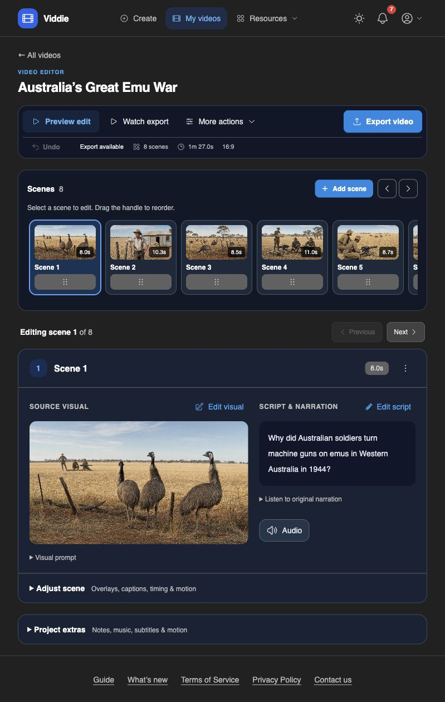
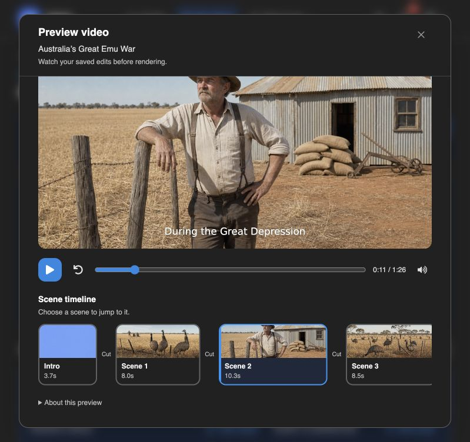

# Viddie

**Turn an idea into an editable video.**

Viddie is a self-hosted video creation app. Start with an AI-generated storyboard or
build a project from your own media, edit each scene, and export a finished video.
The workflow brings scripts, visuals, narration, captions, music, and publishing
into one place.



Explore the [dark-theme screenshot gallery](docs/screenshots.md) for more of the app.

## What you can make

- **AI-assisted videos:** draft a storyboard, review dialogue and visual prompts,
  then generate images, clips, and narration with your chosen providers.
- **Projects from your own media:** upload images, video, and audio, or reuse items
  from your media library.
- **Scene-by-scene edits:** rewrite dialogue, replace visuals, insert and reorder
  scenes, adjust timing, and preview the result before exporting.
- **Finished productions:** add image motion, transitions, captions, overlays,
  background music, intro and outro clips, and an optional SadTalker presenter.
- **Ready-to-share exports:** render landscape, portrait, or square videos, download
  subtitles, create covers, and prepare titles, descriptions, and tags.
- **Connected publishing:** upload exports to YouTube, TikTok, or Instagram
  professional accounts after configuring the platform integrations.

Save generation templates and reusable assets to speed up your next project.
Accounts can use shared service credentials or encrypted personal provider keys.
AI generation requires access to the selected providers and may incur API charges.

## Quick start with Docker

Install Docker with Docker Compose. Run these commands from the repository root:

```sh
cp backend/.env_example backend/.env
```

Edit `backend/.env` and add credentials for the providers you want to use. For an
OpenAI-based workflow, set `OPEN_API_KEY` (the variable is named exactly this).
Leave `ENV` blank for local development.

```sh
cd backend
docker compose up --build
```

Open **[localhost:3000](http://localhost:3000)** when the services are ready.

| Service | Local address |
| --- | --- |
| App | [localhost:3000](http://localhost:3000) |
| API | [localhost:3000/api/](http://localhost:3000/api/) |
| Django admin | [localhost:3000/admin/](http://localhost:3000/admin/) |
| Interactive API documentation | [localhost:3000/swagger/](http://localhost:3000/swagger/) |
| ReDoc | [localhost:3000/redoc/](http://localhost:3000/redoc/) |

The stack starts the React frontend, Django API, Redis, Celery worker, Celery Beat,
and MySQL. **Local settings use SQLite by default**; MySQL is used with production
settings. nginx serves the frontend and media and proxies API requests on the same
origin.

The API applies migrations, loads the voice catalogue, and prepares bundled media
on startup. The worker downloads SadTalker and GFPGAN weights before accepting jobs.
The first startup can take several minutes; downloaded weights and generated media
are retained under the mounted `backend/` directory.

### Create your local account

Sign up through the app and follow the verification link printed in the API logs
(local email is written to the console). To create an administrator instead, open
another terminal and run:

```sh
cd backend
docker compose exec video_creator python manage.py createsuperuser
```

An administrator also needs email verification to sign in through the app. For a
local account, replace `YOUR_USERNAME` below with the username you just created:

```sh
docker compose exec video_creator python manage.py shell -c "from apps.usermanagement.models import User; User.objects.filter(username='YOUR_USERNAME').update(is_verified=True)"
```

Use `localhost` consistently when opening the frontend and API so authentication
cookies stay on the same site.

## Create your first video

1. **Choose a starting point.** Describe your idea for an AI project, or start a
   manual project with your own media. Select the format and generation options.
2. **Review the storyboard.** Edit the dialogue and visual prompts before generating
   media. For AI visuals, refine each shot's framing, camera direction, subject action,
   and target duration. You can save a draft and return to it from **My videos**.
3. **Generate or add media.** Create visuals and narration, upload replacements, or
   select existing assets. Optional references and continuity guidance help keep
   generated scenes visually consistent.
4. **Refine the edit.** Reorder scenes, adjust audio and pauses, choose transitions
   and image motion, and add captions or overlays. Preview the timeline as you work.
5. **Export and share.** Choose Draft, Standard, or High export quality and 24 or
   30 fps in the render dialog. Render the video, create a cover, and edit its metadata.
   Download the result or use **Publish** with a configured destination account.



**Images per scene** in generation settings can request 1–4 AI images for each
narrated scene. Review each image prompt in the storyboard before generation.
Images share the narration and divide the scene time equally; extra images use
additional provider requests. Video clip providers keep one visual per scene.

Use **Add shot** beneath a scene’s visual to upload, reuse, or generate another
image or clip under the same narration. **Manage shots** lets you drag or reorder
shots with arrow buttons, adjust cut points, trim clips, choose image motion, and
remove individual shots. Narration and captions continue across visual cuts.
Shot lengths scale with the scene duration; any ending pause holds the final shot.
Each scene supports up to 20 shots. Existing single-visual scenes work as before.

Export choices are remembered per project. Standard at 24 fps matches previous
exports. Draft favors faster encoding and more compression; High preserves more
source detail with longer encoding and usually larger files. Frame rate applies
to the full export, including motion and transitions. These settings keep your
project dimensions and do not regenerate or improve the source media.

Removed scenes can be restored from **Project extras → Recently deleted** for seven
days. Reusable scene assets remain in the media library after their project is
deleted; assets still used by a scene cannot be deleted from the library.

## Provider configuration

Both Docker and manual installations read [`backend/.env`](backend/.env_example).
The [environment template](backend/.env_example) lists available settings. Blank
values generally use application defaults; credentials are required for whichever
providers you select.

| Purpose | Service credentials |
| --- | --- |
| OpenAI scripts, images, speech, and Sora | `OPEN_API_KEY` |
| Anthropic scripts | `ANTHROPIC_API_KEY` |
| Gemini scripts and video | `GEMINI_API_KEY` |
| ElevenLabs speech | `XI_API_KEY` |
| 60dB speech | `SIXTYDB_API_KEY` |
| Google image search | `API_KEY` and `SEARCH_ENGINE_ID` |
| Kling through fal.ai | `FAL_KEY` |
| Runway video | `RUNWAY_API_KEY` |

The app's **API keys** page manages personal credentials and custom voice, image,
and video providers. Personal keys are encrypted in storage and masked in API
responses. When service keys are disabled, an empty personal key does not fall back
to the server's credential.

The initial catalogue includes OpenAI voices. To import additional voices after
setting their service credentials, run the relevant command from `backend/`:

```sh
docker compose exec video_creator python manage.py setup_elevenlabs
docker compose exec video_creator python manage.py setup_60db
```

Text and image model settings include `DEFAULT_GPT_MODEL`, `MAX_TOKENS`,
`REASONING_TOKEN_ALLOWANCE`, `IMAGE_MODEL`, `IMAGE_QUALITY`, and `IMAGE_SIZE`.
Choose image quality and size values supported by the configured model.

See the guides for [AI video providers](docs/ai-video-providers.md),
[visual continuity](docs/visual-continuity.md), and [AI usage tracking](docs/ai-usage.md).

## Local development

### Frontend with hot reload

With the Docker backend running, stop the container using port 3000:

```sh
cd backend
docker compose stop frontend
```

In another terminal, from the repository root:

```sh
cd frontend
npm ci
npm start
```

Node.js **22.12 or later** is required. Vite serves the app on port 3000 and proxies
backend requests to port 8000. See the [frontend README](frontend/README.md) for
build and test commands.

### Backend without Docker

Use **Python 3.11**, Redis, and FFmpeg with `ffprobe` and the `subtitles` filter
(libass). Install a subtitle font such as DejaVu Sans. On Debian or Ubuntu, Python
dependencies also require `default-libmysqlclient-dev` and `pkg-config`, along with
the system libraries listed in the [Dockerfile](backend/Dockerfile).

Create `backend/.env` from the example if you have not already done so, then set:

```dotenv
CELERY_BROKER_URL=redis://localhost:6379/0
```

From the repository root, create an environment and install dependencies using the
same CPU-only PyTorch versions as Docker and CI:

```sh
python3.11 -m venv .venv
source .venv/bin/activate
cd backend
python -m pip install --upgrade pip
pip install torch==2.14.1 torchvision==0.29.1 --index-url https://download.pytorch.org/whl/cpu
pip install -r requirements/build.txt
PIP_CONSTRAINT=requirements/constraints.txt pip install --no-build-isolation -r requirements/requirements.txt
python manage.py migrate
python manage.py loaddata fixtures/fixtures.json
python manage.py setup_media
python manage.py createsuperuser
uvicorn video_creator.asgi:application --host 0.0.0.0 --port 8000 --lifespan off
```

Verify the local account as described above, omitting the Docker command prefix.
If you plan to use a SadTalker presenter, download its model weights first:

```sh
python manage.py setup_checkpoints
```

With Redis running, start each of the following in a separate terminal, using the
same virtual environment and `backend/` working directory:

```sh
celery -A video_creator worker --loglevel=info --pool=solo
```

```sh
celery -A video_creator beat --loglevel=info
```

The worker handles generation and rendering. Beat runs scheduled maintenance,
including cleanup of expired deleted scenes. Start the frontend separately with
`npm ci` and `npm start` from `frontend/`.

## Deployment and publishing

The quick start is a local development configuration. For a deployment, set
`ENV=prod`, a unique `SECRET_KEY`, explicit `ALLOWED_HOSTS`, `FRONTEND_URL`, SMTP
settings, and MySQL credentials. Serve the app over HTTPS; production authentication
uses secure cookies.

Set a persistent `FIELD_ENCRYPTION_KEY` before storing user credentials and back it
up securely. If unset, it is derived from `SECRET_KEY`; changing that secret then
makes existing provider keys unreadable. Preserve the database, media storage, and
private publishing snapshots across deployments.

Set the database port explicitly for your installation. The supplied MySQL container
listens on port 3306, while production settings default to 3307. For an API container
connecting to the Compose database, use `MYSQL_HOST=db` and `MYSQL_PORT=3306`.
Review database persistence and exposed ports before deploying the Compose stack.

Creator publishing requires registered developer applications and platform-specific
configuration. The [publishing guide](docs/social-publishing.md) covers credentials,
redirect URLs, account requirements, and private export snapshots. It also explains
local HTTPS testing with [`scripts/local-tunnel.py`](scripts/local-tunnel.py).

When updating an installation, apply migrations, restart the API, worker, and Beat,
and rebuild the frontend. Back up persistent data before upgrading.

## Troubleshooting

- **Generation stays queued:** check that Redis and the Celery worker are running.
  On the first Docker startup, the worker must finish downloading model weights.
- **App login fails for an administrator:** verify the account and use `localhost`
  consistently. Admin access alone does not verify an account for frontend login.
- **A provider request fails:** check the selected credential mode, model access,
  and provider balance. Review provider status before retrying paid jobs.
- **Captions fail to render:** confirm FFmpeg includes libass and the configured
  `SUBTITLE_FONT` is installed (the default is `DejaVu Sans`).
- **Frontend changes are missing in Docker:** rebuild the frontend image and recreate
  its container, or use Vite for development.

API errors include an `X-Request-ID` reference. To find matching API and worker logs,
run this from the repository root, replacing `REFERENCE` with that value:

```sh
docker compose -f backend/docker-compose.yml logs video_creator celery | rg 'REFERENCE'
```

Application logs include request and task identifiers to help trace background
failures. Keep logs private because provider errors may contain sensitive details.

## Documentation and contributing

| Guide | Contents |
| --- | --- |
| [Contributing](CONTRIBUTING.md) | Development conventions, checks, tests, and pull requests |
| [Architecture](docs/ARCHITECTURE.md) | API and worker responsibilities, generation, and rendering |
| [Rendering](docs/rendering.md) | Timing, composition, export quality, scene caching, and failure recovery |
| [Frontend](frontend/README.md) | Development server, builds, and frontend checks |
| [AI video providers](docs/ai-video-providers.md) | Provider setup, references, timing, and limitations |
| [Prompting](docs/prompting.md) | Storyboard and visual prompt assembly, with complete GPT request examples |
| [Visual continuity](docs/visual-continuity.md) | References and consistency across generated scenes |
| [AI usage](docs/ai-usage.md) | Usage records and cost estimates |
| [Creator publishing](docs/social-publishing.md) | Social platform integrations and deployment setup |
| [Performance checks](docs/performance-check.md) | Measuring application performance |
| [Dependency security](docs/dependency-security-check.md) | Dependency audit procedure |

The repository contains the Django backend in `backend/`, the React frontend in
`frontend/`, and supporting guides in `docs/`. Third-party code lives in
`backend/vendor/`.

To report a bug, open an issue with reproduction steps and relevant error references.
For security-sensitive reports, email [kostas2372@gmail.com](mailto:kostas2372@gmail.com).
Contributors follow the [Code of Conduct](CODE_OF_CONDUCT.md).

## License

Viddie is licensed under [AGPL-3.0](COPYING.txt). Vendored components retain their
respective licenses.
