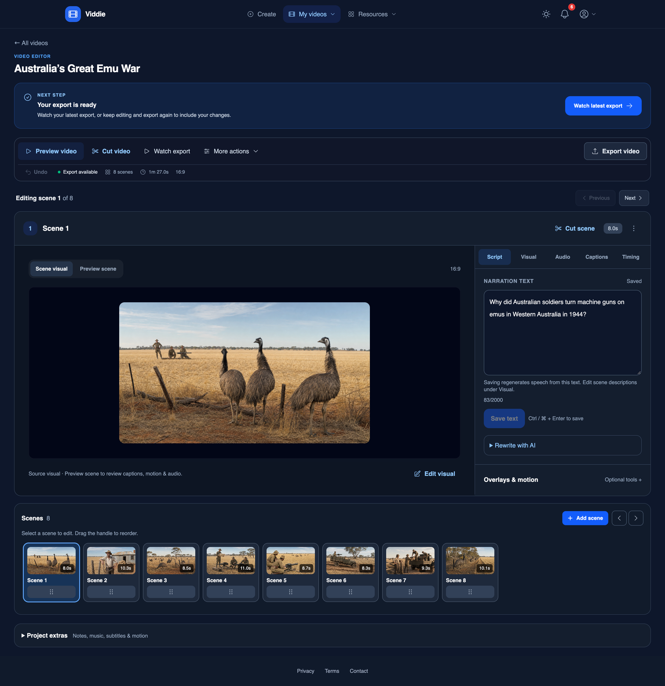

# Viddie

**Turn an idea into an editable video.**

Viddie brings storyboarding, scene editing, narration, captions, and publishing into one video creation workflow.

- Draft a storyboard with AI or start with your own images, clips, and audio.
- Edit scenes, record or generate narration, and add captions, music, and transitions.
- Turn highlights from longer videos into portrait clips.
- Export landscape, portrait, or square videos and publish through connected accounts.

Development continues in a private repository. This repository is Viddie’s public showcase.

[Watch example videos on TikTok](https://www.tiktok.com/@viddieeducation) · [Report an issue](https://github.com/kostas2370/Video-Creator/issues/new/choose)
