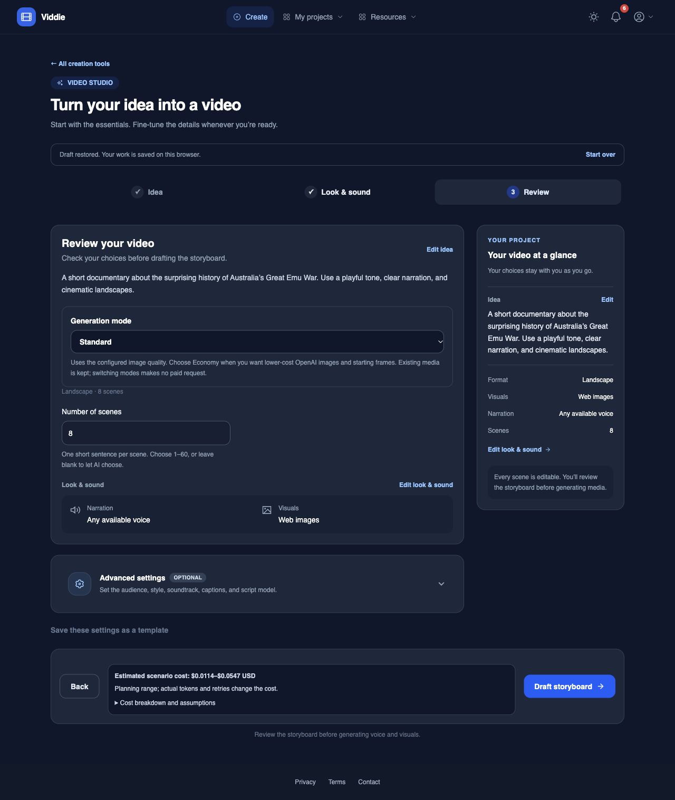
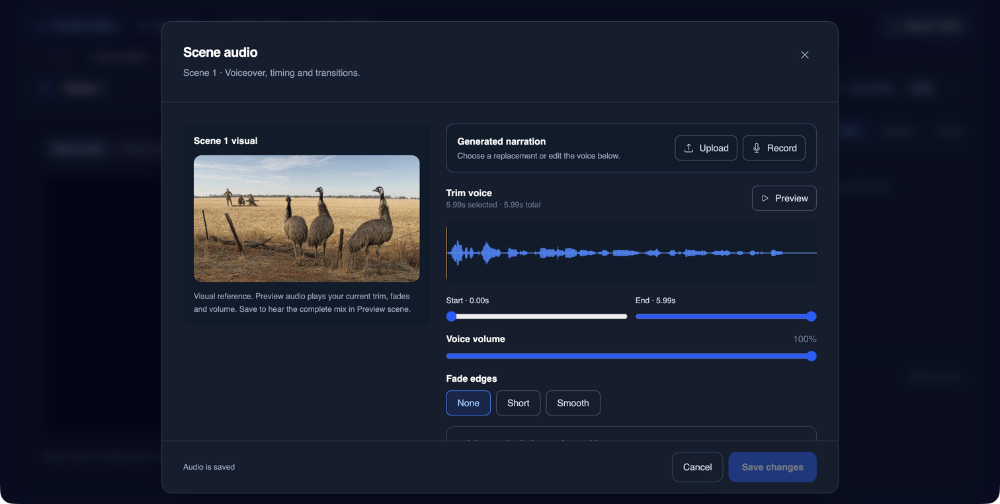

# Viddie

**Turn an idea into an editable video.**

Viddie is a browser-based video creation studio for explainers, short-form clips, and recurring series. Plan a video, edit each scene, and finish with captions, narration, and music in one workspace.

**Visit [viddiecreator.com](https://viddiecreator.com)** · [Watch examples on TikTok](https://www.tiktok.com/@viddieeducation)

## What’s new

**November 2026**

- **Recurring series** save cast references and visual style, then use story notes from finished episodes when drafting the next one.
- **Long video to shorts** adds transcript search and suggested highlights, with controls for trimming, framing, and captions before export.
- **Storyboard revisions** let you review suggested changes to narration and visual prompts before applying them and generating media.

[Read the full release journal](https://viddiecreator.com/whats-new/)

## What you can make

| Workflow | What you can do |
| --- | --- |
| AI-assisted video | Draft a storyboard from an idea, review the script and visual prompts, and generate images, clips, and narration with your chosen providers. |
| Video from your own media | Build scenes with uploaded images, clips, and audio. Reuse media from your library and replace individual assets as the project takes shape. |
| Long video to shorts | Find highlights in transcripts from uploads or YouTube videos, then trim, reframe, caption, and export them as vertical clips. |
| Captioned video | Transcribe existing footage, correct words and timing, style the captions, and export a captioned video or an SRT file. |
| Recurring series | Save a premise, cast, and visual style. Draft new episodes using reviewed notes from earlier stories. |

## From idea to export

1. **Plan the video.** Set the format, tone, and audience. Review the storyboard before generating media, or start with scenes and footage you already have.
2. **Edit scene by scene.** Rewrite dialogue, swap visuals, reorder scenes, and adjust timing and transitions. Upload, record, or generate narration, then mix it with background music.
3. **Finish and share.** Add captions, overlays, and a cover. Export in landscape, portrait, or square format, download subtitles, or publish through a configured YouTube, TikTok, or Instagram connection.

### Storyboard review

Review your settings and the cost estimate before drafting the storyboard.

### Scene audio

Preview narration, trim a take, set its volume, and add short fades from the scene audio editor.

## Access and feedback

The hosted beta is invite-only. Visit [viddiecreator.com](https://viddiecreator.com) for access information.

This repository is Viddie’s public showcase. Development takes place in a private repository. Use [GitHub Issues](https://github.com/kostas2370/Video-Creator/issues) to share feedback or report a bug.
