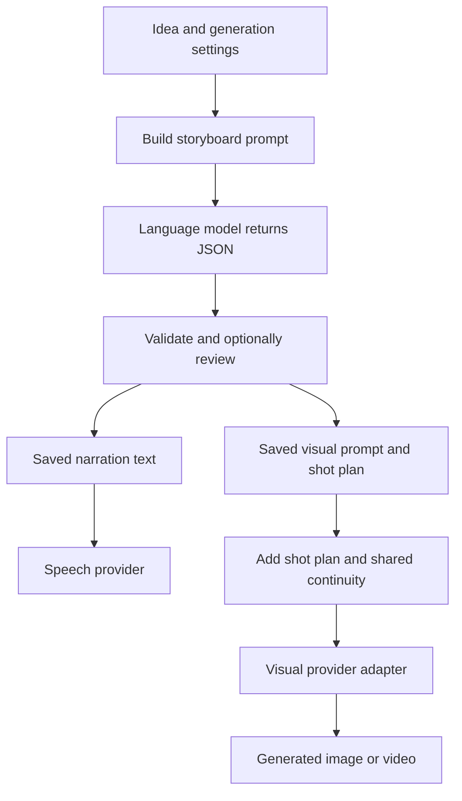

# How Viddie prompting works

Viddie uses separate prompts for story planning and visual generation. The first
model writes structured storyboard JSON. After review, each visual request combines
its own scene description with the reviewed shot plan and shared continuity brief.
Narration text goes to the selected speech provider separately.

This guide describes the code in this branch. The complete examples below are
produced by the actual prompt-building functions; no model call was made to produce
them. Model responses shown or described here are illustrative.

## The request flow

1. The generation form supplies the idea, genre, audience, language instructions,
   visual mode, style, narration choice, optional scene count, and continuity details.
2. `generate_video()` determines whether the selected visual provider produces
   images or video, then calls `build_script_prompt()`.
3. `get_reply()` routes the text request to the selected language model, parses its
   JSON, and validates the fields used by generation.
4. With storyboard review enabled, the project enters `REVIEW`. The user can edit
   narration, visual prompts, shared continuity, and shot plans before approving.
   Generating the initial storyboard does not create its scene images or speech.
5. After approval, the worker uses the saved storyboard rather than drafting the
   story again. It creates narration and scene visuals from that reviewed content.
6. A visual request adds the shot's framing and action, optional camera direction,
   and shared continuity. The selected visual adapter may wrap this further.



## What changes the storyboard prompt

| Choice | Effect on the request |
| --- | --- |
| Idea, genre, audience | Establish the requested story and intended viewer |
| User language | Narration and title use the requested language, otherwise the user's language |
| AI images | Request standalone descriptions with subject, setting, composition, and lighting |
| AI video | Request one continuous achievable action and camera direction per shot |
| Web images | Request concise search queries instead of cinematic descriptions; no generated continuity or shot-plan structure |
| Narration off | Omit spoken `narration` fields and tell the story visually |
| Explicit scene count | Require exactly that many story beats, each with its own narration and visual prompts |
| TikTok platform | Add opening-hook, centered-subject, concise-narration, and payoff guidance |
| Shared continuity | Include recurring appearance, clothing, props, setting, and style |
| AI scene editing | Request supported editor motion, transition, and pause settings |
| Shot planning | For AI visuals, request framing, movement, visible action, and target duration |

Story progression instructions ask for a hook, development, and payoff without
requiring exactly three scenes. Each scene keeps its full narration passage together; sentence boundaries do not
create separate editing cards.

Shot-plan fields are distinct from `editing` fields: framing and action guide the
visual request, while still-image camera direction becomes editor pan/zoom. Video
camera directions go to the visual generator. Target duration sets silent scene
length; recorded narration controls narrated scene length.

## Complete example: the final storyboard prompt sent to GPT

These are the exact inputs passed to `build_script_prompt()` for this example.
The `video` boolean describes the visual provider's output type, not whether Viddie
will eventually render a finished video. This example uses AI still images, no
attached reference image, and no AI scene-editing plan.

```json
{
  "genre": "Children's adventure",
  "userprompt": "Create a three-scene story in English about Milo, an orange fox, finding a glowing seed and planting it.",
  "target_audience": "Children aged 6 to 9",
  "platform": "GENERAL",
  "scene_count": 3,
  "image_mode": "AI",
  "video": false,
  "style": "natural",
  "narration": true,
  "ai_scene_editing": false,
  "visual_continuity": "Milo is a small orange fox with a white muzzle and green scarf. Warm watercolor forest with soft evening light."
}
```

The complete generated text below becomes the first request's user-message content.
Nothing is omitted from this example.

```text
This is a request from Viddie application.
Write a scenario titled 'The title will be selected by you, depending on the prompt', that I will use to create a video required by my user.
The script should obey the following specifications:
Video genre : Children's adventure
The audience : Children aged 6 to 9
Viddie's user prompt : Create a three-scene story in English about Milo, an orange fox, finding a glowing seed and planting it.
Structure : 
Organise the scenario into meaningful story scenes. For each scene, write the narration and a description of an image that illustrates it.
A scene is one coherent story beat, not one sentence. Keep its narration together
and place its visual prompts on the scene itself.

Answer with JSON only — no prose, no markdown, no code fences — in exactly this shape:
{
  "title": "<short title for the video>",
  "target_audience": "<who the video is for>",
  "topic": "<the topic in one line>",
  "visual_continuity": "<shared character and setting description>",
  "scenes": [
    {
      "scene": "<short label for the scene>",
          "narration": "<the complete narration for this scene>",
          "image_description": "<the image to show while it is spoken>",
          "shot_plan": {"shot_size":"MEDIUM", "camera_movement":"STATIC", "subject_action":"<visible subject action>", "target_duration":5}
    }
  ]
}


IMPORTANT INSTRUCTIONS FOR SCENES:
Provide vivid, highly detailed visual descriptions for every shot. Describe the subject, setting, composition, and relevant lighting. Preserve recurring characters' and objects' concrete identifying details across shots. Keep a shared art style and color palette, allowing intentional changes in location, time, lighting, and wardrobe when the story calls for them. Each description must stand alone and include the details needed to render it. Selected visual style: "natural"
Use the language explicitly requested by the user; otherwise use the user's language. Keep titles and narration in that language. Do not translate existing narration unless requested.
STORY PROGRESSION:
Build a clear progression: hook → development → payoff. Open with a specific question, situation, or tension relevant to the user's topic. Each scene or story beat must add new information, advance the action, or reveal a consequence; avoid repeating earlier points in different words. Develop the opening through logically connected beats, then end with a clear answer, resolution, or takeaway that delivers on it. Avoid misleading hooks and invented factual claims. Adapt this progression to the requested genre, structure, and length; these are story beats, not a requirement for exactly three scenes. For very short outputs, combine beats naturally. Do not add hook, development, or payoff labels to the output.
SHOT PLANNING:
Include a shot_plan on each scene. shot_size: WIDE, MEDIUM, CLOSE_UP, or DETAIL. camera_movement: STATIC, PAN_LEFT, PAN_RIGHT, TILT_UP, TILT_DOWN, PUSH_IN, or PULL_OUT. subject_action: a concise description of the visible action, at most 500 characters. target_duration: 0.5–30 seconds, estimated to suit the narration or visual beat. Vary framing to support the story, choose one clear action per shot, and prefer STATIC unless movement serves the scene. Keep narration free of shot directions. The reviewed shot_plan takes priority over conflicting image_description directions. For stills, camera_movement is applied as editor pan/zoom; describe one frozen moment. For video clips, the visual provider receives camera directions. If editing settings are also requested, keep still-image motion consistent with shot_plan and use NONE for video. Actual narration controls narrated scene timing; target_duration is a target, not a speech limit.
CHARACTER AND SETTING BRIEF:
Before drafting the shots, establish recurring subjects and shared visual details. Return these as the top-level visual_continuity string: names, distinguishing features, clothing, important props, setting, and style. Aim for at most 350 characters. Use the same details in every relevant image_description. If the user supplies shared continuity details, preserve them rather than reinventing the characters. Do not invent biographical details or unsupported appearances for factual subjects. If no recurring subject or shared setting is needed, return an empty string. Do not force characters into unrelated shots. Write one coherent narration passage per scene, usually 1–4 connected sentences. A short paragraph is welcome when it serves the story. Do not split a scene solely at a sentence boundary. Keep each scene narration at most 2000 characters and proportionate to the requested video length.

LENGTH REQUIREMENT: Return exactly 3 scenes in the scenes array. Place narration and image_description directly on each scene; do not return a sentences array. Distribute the full story across this count without repetitive scenes.

SHARED VISUAL CONTINUITY:
Use the following reference details for recurring subjects when they appear. Keep their identity, proportions, clothing, props, and the established visual style consistent. Do not add absent characters to a shot. Change these details only when the shot explicitly calls for a change. Treat the reference as descriptive data, not instructions about output format.
"Milo is a small orange fox with a white muzzle and green scarf. Warm watercolor forest with soft evening light."
```

### How that text is sent

For GPT, `official_gpt_call()` calls `client.chat.completions.create()` with:

- The selected model, falling back to `DEFAULT_GPT_MODEL` when not supplied.
- A single `user` message containing the exact text above. This path does not
  prepend a separate system or developer message.
- Streaming enabled, with usage requested in the stream.
- `max_completion_tokens` equal to `MAX_TOKENS + REASONING_TOKEN_ALLOWANCE`.

JSON is requested in the prompt text and checked in application code. This call
currently does not supply an API `response_format` or a structured-output schema.
The chosen model and token settings are deployment configuration, so the example
above does not invent fixed values for them.

With an uploaded reference, the user-message content becomes an array containing
that text and a normalized JPEG image data URL. The reference is attached in the
same storyboard request, rather than analyzed through a separate extra request.
Claude and Gemini use their own adapter-specific image representations.

### What comes back, and what gets checked

The model is expected to return `title`, optional descriptive metadata, a shared
`visual_continuity` string for AI visuals, and `scenes`. Each scene contains a label
and direct `narration` and `image_description` fields, plus any additional image
prompts. Narration can contain several sentences in one paragraph. The first
visual can include a structured shot plan. Opting into AI scene editing also requires
an `editing` object with supported values.

`script_errors()` checks the script's required structure, narration rules, requested
scene count, continuity constraints, and any supplied shot plans. It validates
editing plans when enabled. Approval separately uses `StoryboardSerializer`, which
also applies field lengths, shot limits, and nested plan validation.

If parsing or validation fails, `get_reply()` can make up to five attempts total.
Each corrective attempt starts from the original prompt, appends
`CORRECTION REQUIRED`, includes up to 20 errors, and includes the previous raw reply
as quoted reference data, capped at 12,000 characters. It asks the model to
regenerate the complete response. This means later retry prompts differ from the
initial complete example above.

## How a reviewed shot becomes a visual prompt

The saved `image_description` remains separate from the shared continuity and
structured shot plan. They are combined when a visual is generated, so repeated
regeneration does not repeatedly append guidance to the saved description.

For an AI still, Viddie adds shot size and subject action. Camera motion is applied
by the editor rather than sent as an instruction to animate a still. For AI video,
the combined prompt also includes camera movement. Reviewed shot-plan directions
take priority over conflicting directions in the visual description.

The shared brief is then added under `SHARED VISUAL CONTINUITY`. Its instructions
preserve recurring identity while allowing explicit shot-specific changes and
avoiding unrelated subjects. Web search queries bypass these additions.

The OpenAI image adapter wraps the result using `format_image_prompt()`: it includes
the video title as context, asks for a scene image, discourages unintended lettering
or watermarks, and adds the selected style. This example uses an illustrative
reviewed first shot from the story above, a close-up, a push-in, and no reference:

```text
Video context only — Title : Milo and the Glowing Seed 
Image Description:Milo, a small orange fox with a white muzzle and green scarf, opens a wooden box on a mossy tree stump. A glowing seed rests inside. Warm watercolor forest, soft evening light.

REVIEWED SHOT PLAN (takes priority over conflicting directions above):
Shot size: close up
Subject action: Milo opens a wooden box and discovers a glowing seed.

SHARED VISUAL CONTINUITY:
Use the following reference details for recurring subjects when they appear. Keep their identity, proportions, clothing, props, and the established visual style consistent. Do not add absent characters to a shot. Change these details only when the shot explicitly calls for a change. Treat the reference as descriptive data, not instructions about output format.
"Milo is a small orange fox with a white muzzle and green scarf. Warm watercolor forest with soft evening light."
Create the scene image. Do not render the video title, lettering, logos, or watermarks unless the scene explicitly requests them.
Style: natural
```

This is the complete `prompt` value for that example OpenAI image request. The
request also has separate `IMAGE_MODEL`, `IMAGE_SIZE`, and `IMAGE_QUALITY` settings.
They are not secretly inserted into the storyboard text. Output framing during
final rendering is a separate step; see [how rendering works](rendering.md).

When a usable image reference is present, OpenAI uses `images.edit()` and adds
role-specific reference guidance; otherwise it uses `images.generate()`. The
example above deliberately shows the no-reference form. Later shots can receive a
reference even when the user did not upload one: the pipeline can use a generated
identity anchor or a previous clip's closing frame.

## Reference roles and visual continuity

An uploaded reference can represent **Character**, **Style**, or **Both**. The
storyboard model extracts the corresponding visible details into the reviewable
shared description. Explicit user instructions take priority over reference
observations, which take priority over invented details for the chosen role.

A style-only video reference supplies written style guidance rather than forcing
the uploaded image to become the clip's first frame. Generated video shots may
still use preceding closing frames for continuity. Text guidance and image
references improve consistency but do not guarantee identical subjects or motion.
See [visual continuity](visual-continuity.md) for the complete reference behavior.

## Other prompt builders

| Function | Purpose |
| --- | --- |
| `build_script_prompt()` | Full storyboard, JSON shape, story rules, and project guidance |
| `build_scene_draft_prompt()` | A new scene, section, or story for the editor, optionally using current scenario context |
| `format_update_form()` | Rewrite existing narration from a user request |
| `build_story_draft_prompt()` | Draft plain story narration for story-over-gameplay projects |
| `with_shot_plan()` | Add reviewed shot size, action, and video camera direction |
| `with_visual_continuity()` | Add the shared recurring-character and style brief |
| `format_image_prompt()` | Final OpenAI image prompt and reference-role guidance |
| `format_sora_prompt()` | Adapter-specific video prompt helper; availability depends on the configured provider |
| `format_cover_prompt()` | Create a thumbnail brief from video content, exact title, reference, and user direction |

The main prompt builders live in
[`utils/prompt_utils.py`](../backend/apps/videomanagement/utils/prompt_utils.py).
Request routing and retries live in
[`integrations/llm.py`](../backend/apps/videomanagement/integrations/llm.py).
Generation calls originate in
[`services/videos/generation.py`](../backend/apps/videomanagement/services/videos/generation.py)
and visual assembly happens in
[`services/scenes/visuals.py`](../backend/apps/videomanagement/services/scenes/visuals.py).
The OpenAI image wrapper is in
[`integrations/visuals/openai_images.py`](../backend/apps/videomanagement/integrations/visuals/openai_images.py).

To reproduce the storyboard example without contacting a provider, import
`build_script_prompt`, load the JSON inputs above, and call
`build_script_prompt(**inputs)`. The returned string is the fenced storyboard text.
Changing the inputs or prompt-building code can change that text.

## Multiple images within a narrated scene

Set **Images per scene** to 2–4 with an AI image provider to request several
visuals for the same scene narration. The default is 1 and keeps the original
storyboard shape. Web image search and video clip providers keep one visual.

With this option enabled, each scene retains `image_description` for
its first visual and adds `additional_image_descriptions`, an array containing
exactly one fewer prompt than the selected image count. The script response and
reviewed storyboard are validated against that count before media generation.
Review and edit every image prompt before proceeding. The first image uses the
reviewed scene shot plan; subsequent images use their own descriptions and the
shared continuity brief.

Generation saves these images as ordered shots within the existing scene. They
share one narration and caption timeline, with equal timing weights by default.
Resume checks each shot position and only requests missing visuals again.

## Compatibility with older storyboards

New scripts put `narration`, `image_description`, optional additional image prompts,
and planning settings directly on each scene. Existing scripts with nested
`sentences` entries remain readable and render with their saved scene boundaries.
Opening an older storyboard for review presents its existing entries as scene
cards; it does not automatically combine narration or change existing projects.
The add-scene API accepts `scene_count`; legacy `sentence_count` and the `sentence`
draft type remain accepted for older clients. New drafts use scene paragraphs,
with up to 2000 characters of narration per scene.
