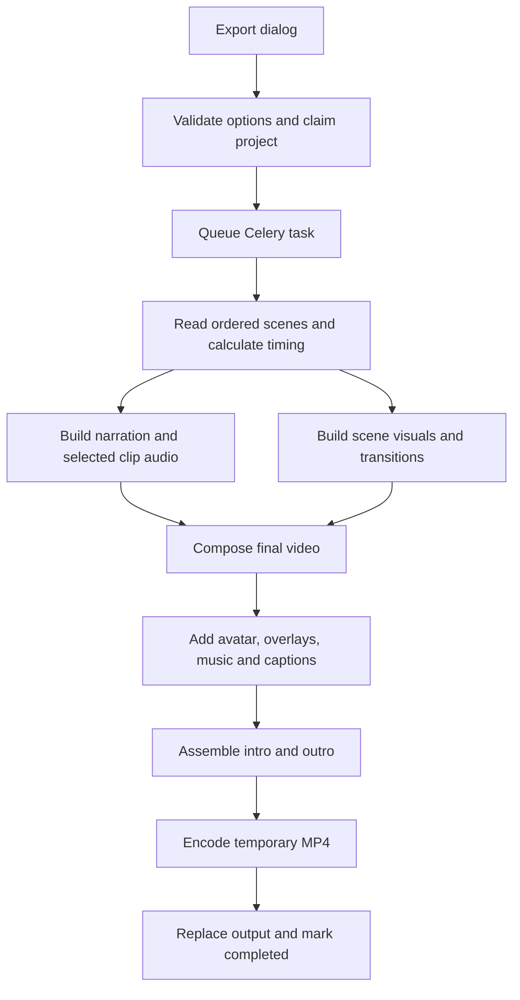

# How Viddie rendering works

Rendering turns the scenes already saved in a project into a downloadable MP4.
It uses native FFmpeg filters and encoders in a Celery worker. Rendering does not
ask an AI provider to regenerate images, video clips, or narration. When captions
are enabled, the renderer also ensures narration alignment is available.

## From clicking Export to getting a video

1. The render dialog loads the project, checks for missing narration, and lets you
   choose export quality and frame rate.
2. `PATCH /api/videos/{id}/render_video/` validates the choices and checks ownership.
   The project must be `READY` or `COMPLETED`; a manual project must have a scene.
3. Inside a database transaction, the service locks the project, saves the selected
   options, and marks it `RENDERING`. This prevents a competing API request from
   starting another render while the project is busy.
4. The API queues `render_video_task` and returns HTTP `202`. The worker loads the
   project and calls `make_video()`.
5. The worker computes scene timing, builds the audio and visuals, adds the final
   layers, and encodes an MP4.
6. After successful encoding, it saves the output reference, marks the project
   `COMPLETED`, and clears the old thumbnail reference so it can be refreshed.
   The app receives status invalidations through its shared SSE connection and
   reloads the current project.

A `202` response means the job was queued. It does not mean the file is ready.

## How long each scene lasts

Active scenes are read in their saved position order. The renderer currently uses
**the first visual attached to each scene**.

With narration enabled, the timing calculation uses edited narration duration and
any enabled clip audio. If both are available, the longer one sets the base length.
The existing final-shot rule can also add an ending hold when narration is present
and the visual's own audio is off. If no usable audio timing is available, the
renderer uses the bundled blank-audio duration, or one second if that cannot be read.

With narration disabled, a video uses its enabled audio duration or its video
length. A still uses `SILENT_SCENE_SECONDS`; manual projects default to five seconds.
An explicit scene duration overrides the computed base length in either mode.
`pause_after` is then added to that base length.

Short video visuals hold their final frame to fill the scene. If the project enables
visual looping, video inputs loop instead. Longer visuals are trimmed to the scene.
Missing visual files produce black frames; missing narration contributes silence.
The render dialog warns about missing narration before submission.

The scene timeline is quantized to whole frames using cumulative end times.
Rounding the accumulated timeline avoids adding a separate rounding error for each
scene. Audio retains its time-based timing.

## Visuals, motion, and transitions

Images and clips are scaled to fill the project canvas, then cropped to fit while
preserving their aspect ratio. The canvas sizes are:

| Format | Dimensions |
| --- | --- |
| Landscape | 1920 × 1080 |
| Portrait | 1080 × 1920 |
| Square | 1080 × 1080 |

Still-image pan and zoom use FFmpeg's `zoompan` filter. Moving stills are first
scaled to twice the canvas dimensions, then sampled into the output frame.
The selected motion intensity determines the amount of movement.

Scene transition choices resolve against project defaults:

- **Cut:** switch directly to the next scene.
- **Fade:** fade the scene in or out; fade durations are bounded by scene length.
- **Dissolve:** blend a held outgoing frame over the start of the incoming scene.
  Between ordinary scenes this is a held-frame blend, rather than an overlap of
  two moving clips. The intro-to-first-scene dissolve uses the moving intro.

Transitions preserve the planned scene duration rather than shortening the project
through overlapping narration. The intro and outro add their own media durations
and keep their available soundtracks.

## Audio and final layers

The worker first writes an uncompressed `output_audio.wav` containing narration and
selected scene-clip audio. Audio is resampled to 44.1 kHz stereo. Voice edits can
apply trimming, gain, fades, delays, and crossfade-related placement.

The final scene-region composition adds:

- A SadTalker presenter, when configured, through the avatar layer.
- Scene overlays, such as titles and watermarks, using their timing and placement.
- Background music, looped and trimmed to the scene region. Music gain and fades
  follow project settings. Optional ducking uses a sampled gain envelope based on
  speech intervals, attack, release, and the chosen duck level.
- Captions, written as an ASS file and burned into the picture through libass.

These scene-region layers are composed before the intro and outro are assembled.
The final audio mix uses the configured gains; this pipeline does not currently
perform final loudness normalization or automatic peak limiting.

## Export quality and frame rate

The render dialog saves `export_preset` and `export_fps` in project settings.
An empty API request keeps the saved choices. Projects without these settings use
Standard quality at 24 fps.

| Quality | H.264 CRF | Encoder preset | Intended use |
| --- | --- | --- | --- |
| Draft | 28 | `veryfast` | Quick reviews with more compression |
| Standard | 23 | `fast` | Balance of detail, encoding time, and file size |
| High | 18 | `slow` | Preserve more source detail, with longer encoding |

Lower CRF generally preserves more detail and produces larger files. Actual size
and render time depend on the source material and machine. These choices do not
change project dimensions or regenerate source media.

Both **24 fps** and **30 fps** are supported. The choice applies to image motion,
scene frame boundaries, clip conversion, transitions, and final output. Selecting
30 fps does not synthesize new motion detail in a lower-frame-rate source clip.

Final output uses H.264 (`libx264`) video, AAC audio, and `yuv420p` pixels in an MP4.
`+faststart` moves MP4 playback metadata toward the beginning of the file.

## Direct rendering and reusable scene clips

Small projects can compose their visuals directly in the final render. This path
requires `FFMPEG_DIRECT_RENDER`, no incoming scene dissolves, and either one scene
or at most three still scenes without motion. Larger or more complex projects
render scenes sequentially into temporary **lossless H.264** clips before assembly.
This keeps the number of simultaneous decoders and filters bounded.

A private scene cache can reuse those lossless clips on later exports. Its keys
include source-file fingerprints, canvas size, frame rate, timing, motion, fades,
and dissolve dependencies. Changing captions, overlays, audio, or final quality
does not invalidate otherwise identical scene visuals. Changing frame rate does.

Cache hits are pinned into the temporary render directory before use so eviction
cannot remove a clip during rendering. The cache is an optimization: unavailable
or unusable entries fall back to rendering. Cache storage inside `MEDIA_ROOT` is
disabled to keep it out of the public media-serving path.

| Server setting | Default | Purpose |
| --- | --- | --- |
| `FFMPEG_RENDER_TIMEOUT` | 3600 seconds | Timeout for each FFmpeg invocation |
| `FFMPEG_DIRECT_RENDER` | Enabled | Allow the small-project direct path |
| `FFMPEG_SCENE_CACHE_ROOT` | `backend/private-render-cache` | Private intermediate clips |
| `FFMPEG_SCENE_CACHE_BYTES` | 512 MiB | Cache storage budget |
| `FFMPEG_SCENE_CACHE_TTL` | 24 hours | Cache expiry |

Set a non-positive cache byte budget or TTL to disable caching. The timeout is
per FFmpeg process, rather than an overall deadline for the entire Celery job.

## Files and failure recovery

Rendering creates a temporary `ffmpeg-render-*` directory inside the project's
working directory. It contains filter scripts, intermediate files, and the temporary
MP4. Temporary files are removed when the render context exits normally or through
a handled exception. A force-killed worker can leave temporary files behind.

The successful MP4 atomically replaces `output_video.mp4` only after FFmpeg exits
successfully. An encoding failure therefore preserves the previous video file;
the audio working file may already have been updated earlier in the render.
Successful rendering updates `Video.output` to the media-relative path.

FFmpeg errors include a bounded tail of its error log. Timeouts and possible
out-of-memory kills receive explicit error descriptions. The Celery task marks the
project `FAILED` when rendering raises an exception. If queue dispatch itself fails,
the API restores the previous status and returns a retryable error; saved export
choices remain available.

The API lock guards competing requests, but worker execution is not fully
idempotent. A broker acknowledgement failure or worker crash still needs the
existing recovery and stalled-job handling. A browser losing its SSE connection
also does not mean the render has stopped.

## Code map

| File | Responsibility |
| --- | --- |
| [`frontend/src/components/RenderModal.js`](../frontend/src/components/RenderModal.js) | Export choices, narration warning, and render tracking |
| [`views/videos.py`](../backend/apps/videomanagement/views/videos.py) | Render API validation and response |
| [`services/videos/jobs.py`](../backend/apps/videomanagement/services/videos/jobs.py) | Project lock, saved options, and queue dispatch |
| [`tasks.py`](../backend/apps/videomanagement/tasks.py) | Worker entry point and failed status |
| [`export_settings.py`](../backend/apps/videomanagement/export_settings.py) | Quality presets, supported frame rates, and defaults |
| [`utils/timing.py`](../backend/apps/videomanagement/utils/timing.py) | Media probing and scene lengths |
| [`services/scenes/timeline.py`](../backend/apps/videomanagement/services/scenes/timeline.py) | Scene playback segments |
| [`services/videos/preview.py`](../backend/apps/videomanagement/services/videos/preview.py) | Shared transition calculations and preview timeline |
| [`utils/composer/render.py`](../backend/apps/videomanagement/utils/composer/render.py) | Native FFmpeg composition and final encoding |
| [`utils/composer/audio.py`](../backend/apps/videomanagement/utils/composer/audio.py) | Voice filters and music ducking envelope |
| [`utils/composer/scene_cache.py`](../backend/apps/videomanagement/utils/composer/scene_cache.py) | Reusable private scene clips |
| [`utils/composer/captions.py`](../backend/apps/videomanagement/utils/composer/captions.py) | ASS caption generation |
| [`utils/composer/overlays.py`](../backend/apps/videomanagement/utils/composer/overlays.py) | Overlay rendering |

The native rendering and cache regression tests are in
[`tests/composer/`](../backend/apps/videomanagement/tests/composer/).
