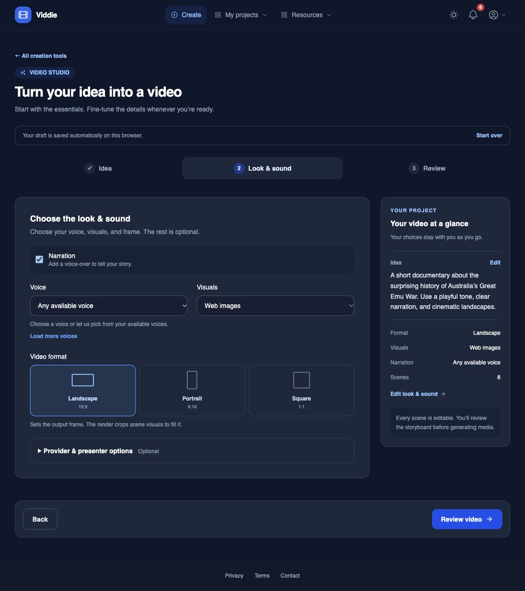
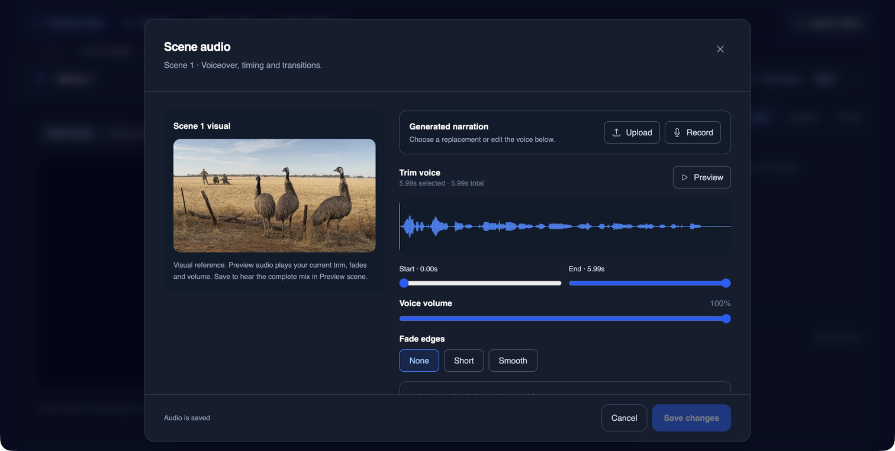
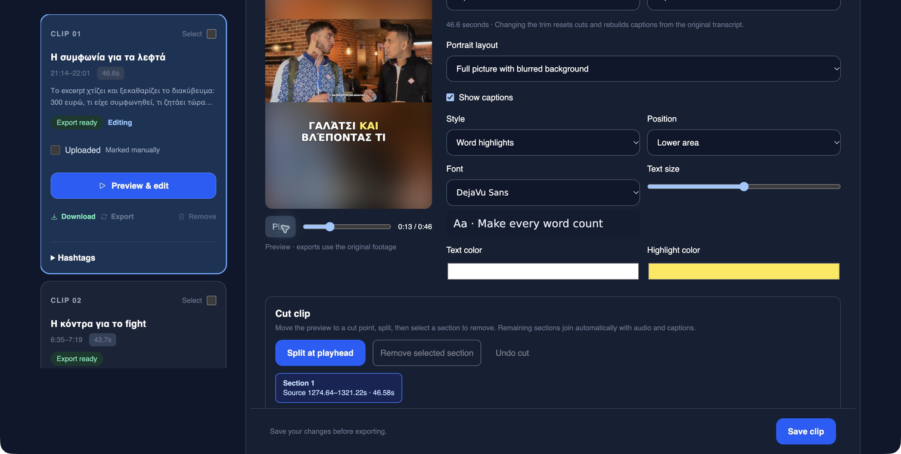

# Viddie UI screenshots

[Back to the README](../README.md)

Nine screenshots from the running app, captured in dark theme on 15 November 2026. Available providers, media, and connected services vary by installation.

## Video editor

Edit scenes beside a visual preview and scene timeline.

## Look and sound

Choose narration, visuals, and the video format before reviewing the project.

## Creation review

Review the project settings and cost estimate before drafting a storyboard.

## Video preview

Watch saved edits and jump between scenes before rendering.

## Scene captions

Correct individual words and their timing alongside the scene preview.

## Scene audio

Trim narration, adjust volume, and add fades using the waveform editor.

## Recurring series

Keep the cast and production settings together, then plan the next episode with saved story memory.

## Long video to Shorts

Reframe clips, style captions, and remove sections before saving and exporting.

## Mobile audio

Review the scene visual and upload or record narration on a narrow screen.

